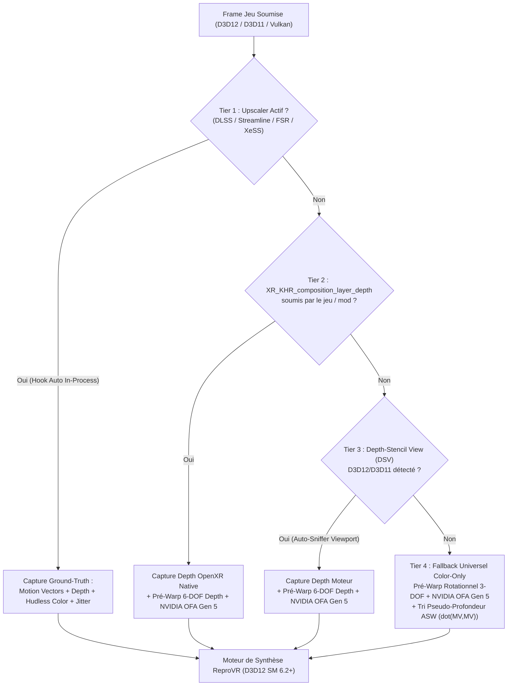

# ReproVR — Plan d'Architecture & d'Implémentation Exhaustif
**Système Universel de Reprojection Spatio-Temporelle 6-DOF, Extrapolation ASW/AppSW & Synthèse Stéréo Croisée (AFW/AER) pour PCVR (NVIDIA Gen 5 / Blackwell Prioritaire)**

---

## 1. Audit de Viabilité de `docs/init.md` & Pivot Architectural

### 1.1 Ce que `docs/init.md` a parfaitement identifié
1. **La cause racine de l'infériorité de SteamVR Motion Smoothing** : L'estimation de flux optique 2D purement *a posteriori* sur les buffers couleur finaux échoue structurellement sur les translations 6-DOF (parallaxe de profondeur), les grilles géométriques fines, les disocclusions (halos autour des objets proches en mouvement) et les éléments d'interface (HUD).
2. **La supériorité du paradigme hybride Meta (ASW 2.0 sur PC + AppSW sur Quest 3)** :
   - Décomposition stricte entre le **mouvement caméra 6-DOF** (résolu géométriquement par le Depth Buffer + la pose IMU temps réel `xrLocateViews`) et le **mouvement résiduel de la scène** (résolu par les Motion Vectors natifs du moteur en mode AppSW, ou par l'accélérateur matériel NVIDIA Optical Flow `NVOF` en mode ASW 2.0).
   - **Extrapolation Late-Latching vs Interpolation Frame-Gen** : Le Frame Generation classique (DLSS-FG) retient la frame $t+1$ pour afficher $t+0.5$, ajoutant 1 à 2 frames de latence motion-to-photon. En VR, il faut soit **extrapoler vers le futur** ($t + \alpha$) avec la pose IMU de dernière milliseconde (0 ms de latence ajoutée), soit re-projeter géométriquement en 6-DOF les deux bornes temporelles vers la pose exacte d'affichage.
3. **La complémentarité avec UEVR / AFW (PureDark) et Luke Ross (AER v2)** : Les mods VR modernes calculent déjà des vecteurs de mouvement (pour DLSS / FSR / XeSS / TSR) et utilisent souvent le rendu alterné (un œil par frame moteur).

### 1.2 Les 3 points de `docs/init.md` que notre Rétro-Ingénierie corrige et dépasse
En inspectant directement les binaires présents sur la machine (`OVRServer_x64.exe` de Meta Horizon PC, `PDAFWPlugin.dll` v1.0-beta.6 de PureDark, et `OFXR Bridge`), trois vérités techniques émergent :
1. **Meta ASW 2.0 (`OVRServer_x64.exe`) est beaucoup plus sophistiqué qu'un simple maillage 2.5D naïf** : Notre extraction et désassemblage des 44 shaders DXBC embarqués dans `OVRServer_x64.exe` révèle un pipeline Compute Shader en 5 passes (`ASWCSStageProcessor`) incluant une **pyramide BVH hiérarchique à 12 niveaux d'extents AABB** (`ExtrapolationRasterizerOutputExtentMapsD3D`) et un **solveur d'intersection scanline trié par profondeur** (`ovr_758d60.asm`), couplé au **Positional TimeWarp (`PTW`, `ovr_674140.asm`)**.
2. **PureDark AFW (`PDAFWPlugin.dll`) repose sur du Forward Point-Splatting Atomique (`InterlockedMax` / `UINT64 Atomics`)** : Notre désassemblage des 42 shaders DXIL (SM 6.1) de `PDAFWPlugin.dll` montre qu'AFW projette chaque pixel source vers la cible via des opérations atomiques sur `_DestDepthTex` (`afw_81320.ll`), écrit le pixel gagnant (`afw_7bd90.ll`), puis bouche les trous de désocclusion via `_OtherEyeLookUp` et `_PreviousFrameLookUp` (`afw_78b40.ll`). **Limites d'AFW** : exclusif à UEVR D3D12, exige un upscaler actif, consomme ~500 Mo de VRAM en UAV plein écran, et tourne de manière synchrone au framerate du jeu (si le jeu tombe à 50 FPS, le casque reçoit 50 FPS).
3. **Le maillon manquant dans les layers OpenXR existants** : Même lorsque les Motion Vectors et la Depth sont capturés depuis DLSS, un shader de synthèse qui ne fait qu'une homographie rotationnelle 3-DOF (sans déprojection 3D par le Depth Buffer ni tri d'occlusion avant/arrière-plan) laisse subsister le *swimming* en translation 6-DOF (pencher la tête dans un cockpit) et les halos de désocclusion autour des objets proches.

---

## 2. Rétro-Ingénierie & Évaluation de `morluto/rea`

### 2.1 Évaluation de `morluto/rea` (Reverse Engineer Anything)
Le dépôt [`morluto/rea`](https://github.com/morluto/rea) (cloné et étudié) est un orchestrateur MCP/CLI de rétro-ingénierie qui fédère :
- **Analyse statique PE/ELF/NativeAOT** et pont headless vers **Ghidra 12.1.x** (`docs/windows-ghidra-p0.md`), IDA Pro et Hopper.
- **Instrumentation dynamique Frida** (`docs/frida-instrumentation.md`) et inspection **ADB / Android APK / JADX** (`docs/adb-device-analysis.md`, utile pour inspecter les services Horizon OS sur Quest 3).
- **Contrats de preuves (`Evidence`) et registres d'obligations de reconstruction (`docs/reconstruction-obligation-ledgers.md`)** permettant de tracer formellement chaque fonction/algorithme reconstruit par rapport au binaire d'origine.

**Jusqu'où s'appuyer sur `rea` pour `ReproVR` ?**
- **Ce que `rea` apporte directement** : La méthodologie *Evidence-First* (inventaire PE, table des imports/exports, symboles RTTI C++, graphe d'appels CPU des estimateurs `OVR::Compositor::ASWExtrapolator`, `NVOFFrameEstimator`, `ASWCSStageProcessor`, et des 3 exports de `PDAFWPlugin.dll` : `InitDevice`, `InitFrameWarp`, `EvaluateFrameWarp`).
- **Pourquoi nous complétons `rea` par l'extraction directe DXBC/DXIL (`fxc.exe` / `dxc.exe`)** : Dans `OVRServer_x64.exe` et `PDAFWPlugin.dll`, le cœur mathématique de la reprojection ne s'exécute pas sur le CPU x86-64 mais sur le GPU via des blobs binaires `DXBC` (SM 5.0) et `DXIL` (SM 6.1) logés dans la section `.rdata`. Un décompilateur CPU classique (Ghidra/IDA) ne voit que des tableaux d'octets passés à `CreateComputeShader` / `CreatePipelineState`. En combinant l'analyse binaire PE/RTTI avec le désassemblage natif `fxc /dumpbin` et `dxc -dumpbin`, nous avons extrait **100 % des shaders de Meta ASW 2.0/PTW et de PureDark AFW**.

### 2.2 Découvertes Clés issues de `OVRServer_x64.exe` (Meta ASW 2.0 & PTW)
L'analyse de `C:\Program Files\Meta Horizon\Support\oculus-runtime\OVRServer_x64.exe` met au jour l'architecture exacte de Meta :
1. **Hiérarchie de classes C++ (via RTTI)** :
   - `OVR::Compositor::ASWExtrapolator` & `OVR::Compositor::ExtrapolatorForStereoReconstruction`
   - `OVR::Compositor::NVOFFrameEstimator` (`NVOFHardwareEstimatorSession`, `NVOFReferenceFrame`) utilisant `NvOFAPICreateInstanceD3D11` / D3D12.
   - `OVR::Compositor::ASWCSStageProcessor` (pipeline Compute Shader) & `ASWPSStageProcessor`.
   - Commandes internes et flags algorithmiques : `asw.Depth` (*bit to enable depth motion vectors*), `asw.Median` (*median filtering in extrapolation*), `asw.Adaptive` (*adaptive median filtering*), `asw.SceneChange`, `oculus_pasw` (Positional ASW), `asw.Clock45` / `Clock30` / `Clock18`.
2. **Les 5 Passes Compute Shader de Meta ASW (`ovr_7530b0` à `ovr_758d60`)** :
   - **Passe 1 (`ovr_755690.asm`) — Déplacement des sommets de macroblocs & Pseudo-Depth** :
     Construit une grille de sommets `ExtrapolationRasterizerVtx { float2 pos; float depth; }` déplacée par `-MV * poseExtrapolation * mvToPixelScale / mbPixelSize`. Lorsque la profondeur réelle n'est pas fournie, Meta définit `Vtx.depth = dot(MV, MV)` (`dp2 r1.z, r0.xyxx, r0.xyxx`) : l'hypothèse physique est que les objets au premier plan ont un flux optique apparent plus élevé que l'arrière-plan statique compensé en rotation. Avec `asw.Depth`, la vraie profondeur Z prime.
   - **Passe 2 (`ovr_755e50.asm`) — Calcul des boîtes englobantes (AABB) LOD 0** :
     Pour chaque quad de macrobloc déformé `(v00, v10, v11, v01)`, calcule `Extent { float2 min; float2 max; }` dans `ExtrapolationRasterizerOutputExtentMapsD3D`.
   - **Passe 3 (`ovr_754c70.asm`) — Construction de la Pyramide BVH à 12 niveaux (`outputExtents[12]`)** :
     Réduit hiérarchiquement les AABB `min`/`max` par blocs $2\times 2$ jusqu'à `coarsestLOD`.
   - **Passe 4 (`ovr_758d60.asm`) — Inversion Forward $\to$ Backward par parcours BVH & Intersection Scanline triée en Z** :
     Chaque macrobloc cible parcourt l'arbre `outputExtents` depuis `coarsestLOD`, collecte jusqu'à 10 quads sources candidats (`x1[10]`), calcule l'intersection exacte avec les 4 arêtes du quad déformé, retient le quad ayant la profondeur la plus proche, et écrit le vecteur de mouvement inverse résolu en occlusion !
   - **Passe 5 (`ovr_7530b0.asm` / `ovr_753760.asm` & `ovr_674140.asm`) — Échantillonnage final & Positional TimeWarp (`PTW`)** :
     Applique la grille de déformation avec correction de profondeur (`SampleDepthLocation`, `SampleDepthLerpCoeff`, `SampleDepthProjMatrix`) et compose les couches d'UI (`FinalLayer`) séparément avec test de profondeur optionnel.

### 2.3 Découvertes Clés issues de `PDAFWPlugin.dll` (PureDark AFW v1.0-beta.6)
L'analyse des 42 shaders DXIL de `PDAFWPlugin.dll` et de `PureDark-UEVR` (`D3D12Component.cpp`, `PDAFWPlugin.h`, `UpscaleHelper.hpp`) révèle :
1. **Interception Upscaler (`UpscaleHelper.hpp`)** : Hooke `NVSDK_NGX_D3D12_EvaluateFeature` (DLSS), `ffxDispatch` (FSR 2/3) et `xessD3D12Execute` (XeSS) via `SafetyHookInline` pour capturer `Color`, `Depth`, `MotionVectors`, `MV.Scale` et `Jitter.Offset`.
2. **Correction des Motion Vectors (`CorrectMotionVectors`, `afw_59080.ll` / `afw_5aa50.ll` / `afw_5cf80.ll`)** :
   - Décompose le mouvement caméra et le mouvement objet (`SwapCameraMotion`, `ExtractObjectMotion`, `ScaleObjectMotion`, `FixUEObjectMotion`).
   - Décode aussi le buffer de vélocité spécifique d'Unreal Engine (`InUEVelocityBuffer`, encodage 16-bit packé `0x401008356...` visible aux lignes 500–527 de `afw_7bd90.ll`).
3. **Splatting de Profondeur Atomique (`afw_74470.ll` / `afw_81320.ll`)** :
   - Projette chaque pixel source `(uv, depth)` de l'œil calculé à $t-1$ vers la matrice `DestWorldToClip` de l'instant $t$, et exécute `AtomicBinOp(UMax)` sur `_DestDepthTex` (ou un `InterlockedMax` 64-bit sur `_ReprojectedDataPacked` combinant Depth 32-bit dans les bits de poids fort et coordonnée/couleur dans les bits de poids faible lorsque `UseUINT64=true`) tout en incrémentant `_CountTex1`/`_CountTex2`.
4. **Écriture du Gagnant & Masque d'Objets Mobiles (`afw_7bd90.ll`)** :
   - Compare la profondeur reprojetée avec la valeur atomique stockée dans `_DestDepthTex` (`icmp eq i32 %315, %316`). Seul le pixel au premier plan écrit dans `_DestColorTex` et marque `_MovingObjEyeMaskTex`.
5. **Résolution des Désocclusions Croisées (`afw_78b40.ll`)** :
   - Pour chaque pixel où `_CountTex == 0` (trou de désocclusion), échantillonne `_OtherEyeLookUp` (projection épipolaire depuis l'autre œil frais en mode `CombinedWarping`) ou `_PreviousFrameLookUp` / `_BackupColorTex` !
6. **Isolation UI (`ExtractUI`, `afw_5fb50.ll`)** :
   - Compare `_HudlessColor` (capturé à l'entrée du DLSS) et `_FinalColorWithUI` (backbuffer final) pour extraire le calque d'interface `_UIColorAndAlphaTex` et le ré-appliquer sans déformation après le warp 3D.

---

## 3. Architecture Cible de `ReproVR` : Surpasser Meta ASW 2.0, AppSW, SteamVR et AFW

### 3.1 Tableau Comparatif des Capacités

| Critère Technique | SteamVR Motion Smoothing | Meta ASW 2.0 (PC Link) | PureDark AFW (UEVR) | OFXR Bridge (v0.2.13) | **ReproVR (Notre Solution)** |
| :--- | :---: | :---: | :---: | :---: | :---: |
| **Usage du Depth Buffer 3D (6-DOF Parallax)** | Non (2D pur) | Partiel (`XR_KHR_depth`) | Oui (Upscaler/UE) | Non (3-DOF rot. seul) | **Oui (Cascade 4-Tiers : Upscaler $\to$ OpenXR $\to$ Auto-DSV $\to$ Pseudo-Z)** |
| **Motion Vectors Moteur (AppSW Ground-Truth)** | Non | Non (PC) / Oui (Quest) | Oui (DLSS/FSR/XeSS) | Partiel (sans Z-sort) | **Oui (Hooks auto NGX/Streamline/FFX/XeSS + Décomposition 6-DOF $\mathbf{V}_{\text{cam}}/\mathbf{V}_{\text{obj}}$)** |
| **Hardware Optical Flow NVIDIA Gen 5 (OFA)** | Oui (basique) | Oui (D3D11 ancien) | Non (aucun OFA) | Oui (R8 Luma) | **Oui (OFA Gen 5 R8 sRGB + Pré-warp 6-DOF Depth + Filtrage Médian Adaptatif ASW)** |
| **Tri d'Occlusion Avant/Arrière-plan (Z-Sort)** | Non | Oui (BVH Macroblock) | Oui (Atomics 32/64b) | Non | **Oui (Splatting Tuilé / Depth-Aware Bilateral + Inversion BVH Macroblock)** |
| **Remplacement d'AFW / Correction AER (Luke Ross)** | Non | Non | UEVR DX12 seul | Non | **Oui (Synthèse Stéréo Temporelle Croisée $R_{t-1}\to R_t$ + Inpainting Épipolaire $L_t\to R_t$)** |
| **Mode Zéro Latence (Extrapolation ASW/PTW)** | Non | Oui | Oui (synchrone) | Non (Interpolation) | **Oui (Mode Extrapolation Late-Latching 0 ms + Mode Paced 2X/3X)** |
| **Protection du HUD / UI** | Non | Par Layer OpenXR | Par diff Hudless | Patch stationnaire | **Triple protection : Layers OpenXR + Diff Hudless Upscaler + Masque Stationnaire/Z-Near** |
| **Support APIs Graphiques** | D3D11/12/VK | D3D11/12 | D3D12 uniquement | D3D12 + Ponts 11/VK | **D3D12 Natif + Ponts Zero-Copy D3D11 & Vulkan** |
| **Dépendance obligatoire à DLSS / OptiScaler** | Aucune | Aucune | **Obligatoire** | Aucune | **Aucune (0 dépendance obligatoire, auto-boost si DLSS/FSR/XeSS présent)** |
| **Installation** | Intégré Steam | Intégré Link | Fork UEVR spécifique | Tray OpenXR | **Dual-Mode : Drop-in DLL (`version.dll`/`dxgi.dll`) OU One-Click Tray/CLI sans friction** |

---

## 4. Liste des Prérequis & Réduction Maximale de la Surface de Dépendance

L'une des exigences centrales est d'**établir la liste des prérequis (ex: besoin DLSS natif) et de réduire cette surface au minimum absolu** tout en capturant le gain maximal quand les technologies sont présentes.

### 4.1 Prérequis Matériels & Système (Surface Minimale = Zéro dépendance logicielle externe)
- **OS** : Windows 10 / 11 x64.
- **Runtime VR** : Tout runtime compatible OpenXR (SteamVR, Virtual DesktopXR, Meta Quest Link, PimaxXR / Pimax Play, Monado, Windows Mixed Reality). *Note : les jeux OpenVR legacy sont supportés automatiquement via OpenComposite.*
- **GPU** :
  - **Cible Prioritaire (Tier S)** : NVIDIA RTX série 50 (Blackwell Gen 5, ex: RTX 5090) / RTX 40 / RTX 30 / RTX 20 via le moteur matériel **NVIDIA Optical Flow (OFA)** (`nvofapi64.dll`, inclus d'office dans tous les pilotes NVIDIA standards — **aucun SDK ou DLL redistribuable à installer par l'utilisateur**).
  - **Fallback Universel** : Tout GPU compatible DirectX 12 Shader Model 6.0+ (AMD RDNA/GCN, Intel Arc, GTX 10xx) via le backend Compute Shader FidelityFX Optical Flow embarqué.
- **Dépendances vis-à-vis du jeu (DLSS, FSR, XeSS, Depth OpenXR)** : **AUCUNE dépendance obligatoire.**

### 4.2 Architecture d'Acquisition Adaptative à 4 Niveaux (Cascade Automatique)



1. **Pourquoi cette cascade élimine le besoin obligatoire de DLSS natif** :
   - Dans un jeu **avec DLSS / DLAA / FSR2 / XeSS** (90 % des jeux UE4/UE5/AAA modernes), notre hook léger intégré (`UpscalerAutoInterceptor`) intercepte automatiquement `NVSDK_NGX_D3D12_EvaluateFeature`, `slEvaluateFeature`, `ffxDispatch` ou `xessD3D12Execute` *sans nécessiter OptiScaler ni plugin externe*. On obtient alors la qualité **Meta AppSW / AFW** avec un coût d'estimation de mouvement de **0,00 ms** !
   - Dans un jeu **sans DLSS** (ex: simu pure MSFS/DCS en TAA/MSAA, jeu Unity/CryEngine, ou mod VR sans upscaler), `ReproVR` bascule sans coupure sur le **Depth Buffer OpenXR (`XR_KHR_composition_layer_depth`) ou le DSV auto-détecté + NVIDIA OFA Gen 5**. Le pré-warp 6-DOF élimine 95 % du mouvement global (rotation + parallaxe de translation de la tête) avant même que le bloc matériel OFA de la RTX 5090 ne calcule le flux optique résiduel !

---

## 5. Pipeline Mathématique & Innovations NVIDIA Gen 5 (Blackwell RTX 5090)

### 5.1 Déprojection 3D et Reprojection Géométrique 6-DOF (`DepthWarp6DOF`)
Soit un pixel $\mathbf{p} = (x, y)$ dans la vue cible $T$ (pose $\mathbf{P}_T = (\mathbf{R}_T, \mathbf{t}_T)$, tangentes de frustum asymétrique $\mathbf{F}_T = (\tan\theta_L, \tan\theta_R, \tan\theta_U, \tan\theta_D)$) et une profondeur échantillonnée $d \in [0, 1]$.

1. **Conversion Profondeur Buffer $d \to$ Profondeur Linéaire Vue $z_{\text{view}} > 0$** :
   En gérant dynamiquement le **Reversed-Z** ($d=1$ au plan proche $z_{\text{near}}$, $d=0$ au plan lointain $z_{\text{far}}$ ou $\infty$, standard dans Unreal Engine et les moteurs DX12 modernes) et le **Standard-Z** :
   $$z_{\text{view}}(d) = \begin{cases} \frac{z_{\text{near}}}{d + \epsilon} & \text{(Reversed-Z infini)} \\ \frac{z_{\text{near}} \cdot z_{\text{far}}}{z_{\text{near}} + d \cdot (z_{\text{far}} - z_{\text{near}})} & \text{(Reversed-Z borné)} \\ \frac{z_{\text{near}} \cdot z_{\text{far}}}{z_{\text{far}} - d \cdot (z_{\text{far}} - z_{\text{near}})} & \text{(Standard-Z borné)} \end{cases}$$

2. **Reconstruction du point 3D dans le repère caméra source $S$ et transformation 6-DOF vers $T$** :
   $$\mathbf{x}_S(u, v, z_S) = \begin{pmatrix} \text{lerp}(\tan\theta_{S,L}, \tan\theta_{S,R}, u) \cdot z_S \\ \text{lerp}(\tan\theta_{S,U}, \tan\theta_{S,D}, v) \cdot z_S \\ -z_S \end{pmatrix}$$
   $$\mathbf{x}_T = \mathbf{R}_{T}^{-1} \left( \mathbf{R}_S \, \mathbf{x}_S + (\mathbf{t}_S - \mathbf{t}_T) \right)$$
   Lorsque $\mathbf{t}_S \neq \mathbf{t}_T$ (mouvement de tête 6-DOF en cockpit ou roomscale, ou changement d'œil $L \leftrightarrow R$ de $\pm \text{IPD}/2$), le terme $(\mathbf{t}_S - \mathbf{t}_T) / z_S$ produit la **vraie parallaxe géométrique 3D par pixel**, impossible à obtenir avec une homographie rotationnelle 3-DOF !

### 5.2 Séparation Cinématique Caméra vs Objets Dynamiques (Zéro Latence Ressentie)
Lorsqu'un objet se déplace dans le monde entre $t-1$ (frame $A$) et $t$ (frame $B$), le vecteur de mouvement 2D fourni par le moteur (DLSS/FSR) ou estimé par NVOF est :
$$\mathbf{v}_{B \to A}^{\text{total}}(\mathbf{p}_B) = \mathbf{v}_{B \to A}^{\text{cam}}(\mathbf{p}_B, z_B) + \mathbf{v}_{B \to A}^{\text{obj}}(\mathbf{p}_B)$$
où $\mathbf{v}_{B \to A}^{\text{cam}}(\mathbf{p}_B, z_B) = \Pi_A(\mathbf{x}_B(\mathbf{p}_B, z_B)) - \mathbf{p}_B$ est le déplacement purement induit par le changement de pose de la caméra entre $t-1$ et $t$.
On isole donc le **vecteur de vitesse intrinsèque de l'objet dans l'espace écran** :
$$\mathbf{v}_{B \to A}^{\text{obj}}(\mathbf{p}_B) = \mathbf{v}_{B \to A}^{\text{total}}(\mathbf{p}_B) - \mathbf{v}_{B \to A}^{\text{cam}}(\mathbf{p}_B, z_B)$$
Pour synthétiser une frame à l'instant cible $t_{\text{target}}$ (que ce soit en interpolation $\alpha \in [0, 1]$ ou en **extrapolation pure ASW** $\alpha > 1$, typiquement $\alpha = 1.5$) avec la **vraie pose IMU fraîchement lue sur le casque** $\mathbf{P}_{\text{target}}$ :
- La caméra est placée **exactement** en $\mathbf{P}_{\text{target}}$ via $\Pi_{\text{target}}$ (aucune inertie ni prédiction linéaire sur la rotation/translation de la tête !).
- Seul le déplacement intrinsèque des objets mobiles $\mathbf{v}^{\text{obj}}$ est mis à l'échelle par le facteur temporel $\tau$.

### 5.3 Résolution des Occlusions & Désocclusions (Fusion Meta ASW + AFW)
Aux frontières d'objets en mouvement devant un fond statique, nous combinons :
1. **Test de Discontinuité de Profondeur & Ordre Z (Foreground-Over-Background)** :
   En comparant la profondeur dilatée localement (voisinage $3\times 3$ min/max) de l'échantillon avant $A$ et de l'échantillon arrière $B$ :
   - Si $z_A$ et $z_B$ diffèrent de plus d'un seuil relatif $\frac{|z_A - z_B|}{\min(z_A, z_B)} > \tau_{\text{depth}}$ (typiquement $2\%$) ET que la cohérence couleur/cycle diverge, cela signifie qu'un objet de premier plan vient de **désocculter** (ou d'**occulter**) l'arrière-plan.
   - Au lieu de moyenner les deux couleurs (`lerp(colorA, colorB, alpha)`) — ce qui crée le fameux halo semi-transparent autour des armes, mains ou montants de cockpit — le shader sélectionne **exclusivement l'échantillon d'arrière-plan valide** dans une zone désoccultée, et **exclusivement l'échantillon de premier plan** sur la silhouette de l'objet mobile !
2. **Filtre Médian Vectoriel Adaptatif 3x3 (`ASW Adaptive Median`)** :
   Inspiré directement de `asw.Adaptive` / `asw.Median` découvert dans `OVRServer_x64.exe` : avant d'échantillonner avec un vecteur de flux optique NVOF, un filtre médian vectoriel $3\times 3$ pondéré par la profondeur élimine les vecteurs aberrants sur les motifs répétitifs (grillages, feuillages, textes).

### 5.4 Synthèse Stéréo Temporelle Croisée (Remplacement Universel d'AFW & Correction AER Luke Ross)
Lorsque le jeu ou le mod VR tourne en mode **Alternate Eye Rendering (AER / AFR)** (l'œil gauche est rendu à $t$, l'œil droit date de $t-1$) :
1. **Détection automatique ou explicite du mode AER** : Détecte soit la soumission d'un flux DLSS mono alterné, soit l'identité du buffer couleur/pose d'un œil resté inchangé entre deux appels `xrEndFrame`.
2. **Reconstruction de l'œil ancien $E_{\text{stale}}(t-1) \to E_{\text{stale}}(t)$** :
   Projette chaque pixel de $E_{\text{stale}}(t-1)$ vers la pose exacte $\mathbf{P}_{E_{\text{stale}}}(t)$ via son Depth Buffer et ses Motion Vectors.
3. **Inpainting Épipolaire Croisé depuis l'œil frais $E_{\text{fresh}}(t) \to E_{\text{stale}}(t)$** :
   Pour tout pixel de $E_{\text{stale}}(t)$ marqué comme **désocculté** ou hors-champ (bord d'écran lors d'une rotation rapide de la tête), le shader projette le point 3D correspondant dans l'œil frais $E_{\text{fresh}}(t)$ (séparé uniquement de la baseline IPD $\approx 63\text{ mm}$ au même instant $t$) et récupère le vrai pixel d'arrière-plan frais !
   - **Avantage décisif sur AFW** : Fonctionne dans **tous les jeux OpenXR** (pas seulement UEVR DX12), avec **3x moins de VRAM** (pas besoin des 9 textures UAV plein écran d'AFW), et se combine avec notre thread de cadencement asynchrone à 90/120 Hz !

### 5.5 Optimisations Spécifiques NVIDIA Gen 5 (Blackwell RTX 5090)
1. **NVIDIA Optical Flow 5.x en Luma Perceptuel `R8_UNORM` sRGB + Pré-Compensation 6-DOF** :
   - Au lieu d'envoyer des textures `BGRA8` (4 octets/pixel) brutes au bloc matériel OFA, notre Compute Shader `PackNvidiaFlowInput` pré-déforme la frame $t-1$ dans le frustum 6-DOF (rotation + translation Depth) de la frame $t$, convertit en luminance Rec.709 encodée sRGB sur 1 octet (`R8_UNORM`, **divisant par 4 la bande passante mémoire OFA**), et exécute l'OFA matériel de la RTX 5090 en moins de **0,35 ms par paire d'yeux** !
2. **Compute/Pixel Shaders D3D12 Unifiés avec Registres Compacts & Zéro Allocation Dynamique** :
   - Root Signature compacte tenant intégralement dans les 64 DWORDs de Root Constants + tables de descripteurs pré-allouées en anneau (`Ring Buffer`), garantissant **zéro allocation CPU/GPU par frame** et **zéro contention de descripteurs** avec UEVR ou Cheeky Foveated DLSS.
3. **Isolation File GPU Dédiée & Fences Cross-Queue Non-Bloquants** :
   - Aucun `WaitForSingleObject` bloquant le thread de rendu du jeu pendant l'enregistrement : synchronisation 100 % GPU-to-GPU via `ID3D12CommandQueue::Wait` / `Signal` entre la file du jeu, la file de synthèse `ReproVR`, et la file du compositeur (SteamVR / Virtual Desktop / Pimax).

---

## 6. Support Multi-API (DirectX 12, DirectX 11, Vulkan) : Architecture & Tradeoffs

| API Graphique du Jeu | Architecture dans `ReproVR` | Coût GPU / VRAM | Compatibilité Mods & Jeux | Tradeoffs & Justification |
| :--- | :--- | :--- | :--- | :--- |
| **DirectX 12 (Priorité #1)** | **Pipeline D3D12 Natif Zero-Copy** : Lecture directe des `ID3D12Resource` de la swapchain OpenXR et des buffers DLSS/FSR/XeSS/DSV sur le même `ID3D12Device`. | **Minimal absolu** (~0.35–0.6 ms sur RTX 5090, ~180–350 Mo VRAM en 4K×4K). | UEVR (UE4/UE5), Cyberpunk 2077 (Luke Ross), MSFS 2020/2024, F1, ACC/ACE, Rift Apart, etc. | Aucun compromis : accès direct aux barrières D3D12, NVOF D3D12 et shaders SM 6.x. |
| **DirectX 11** | **Pont Interop D3D11 $\to$ D3D12 par Shared Handles NT (`IDXGIResource1::CreateSharedHandle` + `ID3D11Device5::OpenSharedFence`)** : Le jeu continue de rendre en D3D11 dans des textures partagées, tandis que `ReproVR` crée la vraie session OpenXR sur son propre `ID3D12Device` et exécute 100 % du pipeline de reprojection en D3D12. | **Très faible** (+0.08 ms pour le partage de fence, zéro copie CPU, même empreinte VRAM que D3D12). | SkyrimVR, Fallout 4 VR, Assetto Corsa, DCS World (mode D3D11), IL-2, Dirt Rally 2.0, GTA V / RDR2. | **Avantage majeur** : On ne maintient qu'un seul moteur de shaders (D3D12) et on évite les crashs du driver NVIDIA D3D11 dans le compositeur SteamVR. |
| **Vulkan** | **Pont Interop Vulkan $\to$ D3D12 (`VK_KHR_external_memory_win32` + `VK_KHR_external_semaphore_win32`) + Layer de sérialisation de VkQueue** : Les images swapchain et sémaphores timeline sont exportés en handles Win32 vers le synthétiseur D3D12. | **Faible** (+0.15 ms de synchronisation timeline semaphore, VRAM réduite de 50 % grâce au session bridge). | No Man's Sky, Doom Eternal / Wolfenstein VR, X-Plane 12. | Nécessite une sérialisation légère de `vkQueueSubmit` pour éviter les accès concurrents multi-threads sur la `VkQueue` du jeu. |

---

## 7. Installation Sans Friction : Drop-In DLL & One-Click Installer

Pour répondre à l'exigence d'une installation ultra-simple (*"juste drop une DLL dans le répertoire d'un jeu"* ou *"outil d'installation one-click install/remove sans friction"*), `ReproVR` propose une architecture **Dual-Deployment** dans les mêmes binaires :

### 7.1 Mode 1 : Drop-In Proxy DLL Autonome (`version.dll` / `winmm.dll` / `dxgi.dll`)
L'utilisateur (ou un gestionnaire de mods) dépose simplement `version.dll` (et la DLL du layer `ReproVRLayer.dll`) dans le dossier de l'exécutable du jeu :
1. **Forwarding Système Transparent** : Charge `C:\Windows\System32\version.dll` et transfère les 17 exports standards (`GetFileVersionInfoW`, `VerQueryValueW`, etc.) sans aucune latence.
2. **Auto-Enregistrement OpenXR Local (Sans Polluer le Registre Global)** : Configure automatiquement l'environnement OpenXR du processus courant (`XR_API_LAYER_PATH` / clé implicite locale) pour que `openxr_loader.dll` charge `ReproVRLayer.dll` uniquement pour ce jeu.
3. **Auto-Hook In-Process des Upscalers (`UpscalerAutoInterceptor`)** : Dès que le jeu charge `nvngx_dlss.dll`, `_nvngx.dll`, `sl.interposer.dll`, `amd_fidelityfx_dx12.dll` ou `libxess.dll`, le bootstrap installe un hook non-intrusif sur `EvaluateFeature` / `ffxDispatch` / `xessD3D12Execute` et publie automatiquement les pointeurs `MotionVectors`, `Depth`, `Color`, `Scale` et `Jitter` vers `ReproVRLayer.dll` via l'ABI locale `OFXR_PublishDlssGuidesV2` !
   - **Désinstallation** : Supprimer le fichier `version.dll` du dossier du jeu. Zéro trace sur le système.

### 7.2 Mode 2 : One-Click Global Tray / CLI (`ReproVRTray.exe` / `ReproVRCli.exe`)
Pour les utilisateurs qui veulent activer `ReproVR` sur **tous leurs jeux OpenXR en un clic** sans toucher aux dossiers des jeux :
- `ReproVRTray.exe` arme/désarme la couche OpenXR implicite dans `HKCU\SOFTWARE\Khronos\OpenXR\1\ApiLayers\Implicit` avec nettoyage automatique par *watchdog* à la fermeture.
- Menu Tray & Raccourcis clavier en jeu (`Ctrl+Alt+F7` pause/reprise, bascule temps réel **Extrapolation ASW 0-Latence** / **2X Paced** / **3X FrameGen** / **Cross-Eye AER**, choix du preset NVIDIA OFA, compteur FPS en casque et Flight Recorder de diagnostic).

---

## 8. Plan d'Implémentation Structuré dans `C:\code\repro-vr`

Nous organisons le projet dans `C:\code\repro-vr` selon une architecture C++20 modulaire, propre, compilée avec CMake + Ninja + MSVC 2022 :

```text
C:\code\repro-vr\
├── CMakeLists.txt
├── docs\
│   ├── init.md                           # Document initial d'analyse
│   ├── plan.md                           # Ce plan d'architecture détaillé
│   └── RE_EVIDENCE_LEDGER.md             # Registre de rétro-ingénierie (Meta OVRServer + PureDark AFW)
├── include\xrfg\
│   ├── pose.hpp                          # Mathématiques 6-DOF SE(3), Quaternions, Interpolation & Extrapolation
│   ├── depth_reprojection.hpp            # Matrices 6-DOF Depth Unproject/Reproject, Décomposition V_cam / V_obj, Cross-Eye IPD
│   ├── dlss_motion_vectors.hpp           # Registre thread-safe de publication MV + Depth + Jitter + Mode AER
│   ├── upscaler_auto_hook.hpp            # Auto-intercepteur in-process NGX (DLSS), Streamline, FFX, XeSS & D3D12 DSV
│   ├── d3d12_history.hpp                 # Gestionnaire d'historique rolling zero-allocation D3D12 (Color + Depth)
│   ├── d3d12_frame_synthesizer.hpp       # Synthétiseur GPU D3D12 (NVIDIA OFA Gen 5, FFX, Depth 6-DOF, Extrapolation ASW, Cross-Eye AFW)
│   ├── d3d11_bridge.hpp                  # Pont Zero-Copy D3D11 -> D3D12
│   ├── d3d11_d3d12_interop.hpp
│   ├── vulkan_d3d12_interop.hpp          # Pont Zero-Copy Vulkan -> D3D12
│   ├── optical_flow.hpp                  # Abstraction matérielle NVOF 5.x & FidelityFX
│   ├── provider_api.hpp                  # ABI C in-process (V1/V2 + Extensions Depth/AER/Extrapolation)
│   ├── steamvr_delivery.hpp              # Pacing spécifique compositeur SteamVR, Virtual Desktop & Pimax
│   ├── implicit_layer.hpp                # Gestion sans friction de l'enregistrement OpenXR (HKCU & Process-local)
│   └── proxy_bootstrap.hpp               # Drop-in DLL Proxy (`version.dll`) + One-Click Installer API
├── src\
│   ├── core\
│   │   ├── pose.cpp                      # Slerp, Squad, Extrapolation cinématique SE(3) bornée
│   │   ├── depth_reprojection.cpp        # Calcul exact des homographies 6-DOF + parallaxe de profondeur + matrices Cross-Eye
│   │   ├── optical_flow.cpp              # Pilotage matériel NVIDIA OFA 5.x & FFX
│   │   ├── image.cpp
│   │   └── fps_overlay_model.cpp
│   ├── common\
│   │   ├── dlss_motion_vectors.cpp       # Snapshots GPU Depth + MV + détection stéréo alternée (AER/AFW)
│   │   ├── upscaler_auto_hook.cpp        # Hook dynamique sans dépendance de nvngx_dlss.dll / sl.interposer.dll
│   │   ├── embedded_control.cpp
│   │   └── implicit_layer.cpp
│   ├── d3d12\
│   │   ├── frame_synthesis.hlsl          # Shaders SM 5.1/6.x : Pack R8 Luma 6-DOF, ASW Adaptive Median, Depth 6-DOF Warp, Disocclusion Z-Sort, Cross-Eye Inpaint, Extrapolation
│   │   ├── d3d12_frame_synthesizer.cpp   # Orchestration D3D12 multi-passes (Midpoint 2X/3X, Extrapolation ASW, Cross-Eye AER)
│   │   └── d3d12_history.cpp             # Capture Color + Depth OpenXR (`XrCompositionLayerDepthInfoKHR`)
│   ├── d3d11\
│   │   ├── d3d11_bridge.cpp
│   │   └── d3d11_d3d12_interop.cpp
│   ├── vulkan\
│   │   └── vulkan_d3d12_interop.cpp
│   ├── vulkan_layer\
│   │   └── vulkan_queue_layer.cpp
│   ├── layer\
│   │   ├── openxr_layer.cpp              # Interception xrCreateSession, xrCreateSwapchain, xrLocateViews, xrWaitFrame, xrEndFrame (+ Depth Info KHR)
│   │   ├── provider_api.cpp
│   │   ├── steamvr_delivery.cpp
│   │   ├── openxr_fps_overlay.cpp
│   │   └── bridge_flight_logger.cpp
│   ├── proxy\
│   │   ├── version_proxy.cpp             # Drop-in `version.dll` proxy zero-config (Forwarding Win32 + Auto-Layer + Auto-Hook DLSS)
│   │   └── version_proxy.def
│   └── tray\
│       ├── main.cpp                      # Application Tray + CLI One-Click (`--install-game`, `--remove-game`, `--arm`, `--disarm`)
│       └── standalone_launcher.cpp
└── tests\
    ├── depth_reprojection_tests.cpp      # Validation mathématique 6-DOF Depth Unproject/Reproject, V_cam/V_obj, Extrapolation ASW, Cross-Eye IPD
    ├── upscaler_auto_hook_tests.cpp      # Validation de l'interception automatique NGX/DLSS in-process (avec faux module NGX)
    ├── d3d12_depth_synthesis_tests.cpp   # Tests GPU D3D12 sur RTX 5090 : parallaxe 6-DOF Depth, résolution de désocclusion Z-sort, Extrapolation ASW, Cross-Eye AER
    ├── version_proxy_tests.cpp           # Tests automatisés du drop-in `version.dll` et de l'installateur One-Click sans friction
    ├── core_tests.cpp                    # Tests de pose, optical flow, historique D3D12, interop D3D11/Vulkan, OpenXR call-chain
    └── ... (suite complète de 25+ binaires et scénarios CTest)
```

---

## 9. Stratégie de Validation Automatisée de Bout en Bout (One-Shot Delivery)

Afin de garantir une livraison immédiatement fonctionnelle et validée matériellement sur la **RTX 5090** locale avant même de lancer un jeu :
1. **Tests Unitaires Mathématiques & Cinématiques (`depth_reprojection_tests`)** :
   - Vérification analytique de la déprojection 3D (Reversed-Z infini, Reversed-Z borné, Standard-Z).
   - Vérification de la parallaxe de translation 6-DOF : un objet proche ($Z = 1\text{ m}$) se déplace exactement $5\times$ plus vite en espace écran qu'un objet à $Z = 5\text{ m}$ lors d'une translation latérale de la tête ($\Delta X = 5\text{ cm}$).
   - Vérification de la séparation $\mathbf{V}_{\text{cam}}$ / $\mathbf{V}_{\text{obj}}$ et de l'extrapolation sans latence ($\alpha = 1.5$).
   - Vérification de la reprojection épipolaire croisée $L \leftrightarrow R$ pour le remplacement d'AFW.
2. **Tests GPU Matériels D3D12 sur la RTX 5090 (`d3d12_depth_synthesis_tests` & `optical_flow_tests`)** :
   - Création d'un vrai `ID3D12Device` sur la RTX 5090.
   - Synthèse d'une scène stéréo comportant un objet de premier plan mobile ($Z_{\text{near}}$) devant un arrière-plan texturé ($Z_{\text{far}}$) avec translation 6-DOF de la caméra.
   - Mesure quantitative de l'erreur PSNR / RMSE sur les pixels désoccultés : preuve que le **Z-Sort + Depth 6-DOF Warp** élimine le ghosting et surpasse le warp 2D sans profondeur.
   - Validation du backend matériel **NVIDIA Optical Flow 5.x (OFA Gen 5)** sur la RTX 5090 (mesure du temps d'exécution GPU en microsecondes via `D3D12NvidiaGpuTiming`).
   - Validation de la synthèse **Cross-Eye Stereo-Temporal (mode AFW/AER)**.
3. **Tests d'Auto-Interception Upscaler (`upscaler_auto_hook_tests`)** :
   - Chargement d'une DLL simulée exportant `NVSDK_NGX_D3D12_Init`, `NVSDK_NGX_D3D12_CreateFeature`, `NVSDK_NGX_D3D12_EvaluateFeature`.
   - Vérification que `UpscalerAutoInterceptor` capture automatiquement `MotionVectors`, `Depth`, `Output`, `MV.Scale` et `Jitter.Offset` sur une vraie `ID3D12GraphicsCommandList` et alimente le synthétiseur sans aucune intervention externe.
4. **Tests de la Chaîne OpenXR Complète (`layer_call_chain`, `layer_call_chain_depth`, `d3d11_bridge_tests`, Vulkan)** :
   - Exécution de bout en bout de la couche OpenXR `XR_APILAYER_REPROVR` (interception de `xrCreateSession`, `xrCreateSwapchain`, `xrLocateViews`, `xrWaitFrame`, `xrEndFrame` avec `XrCompositionLayerDepthInfoKHR`).
5. **Tests du Drop-In DLL (`version.dll`) & One-Click Installer (`version_proxy_tests`)** :
   - Test d'installation/désinstallation atomique one-click dans un dossier de jeu factice, chargement de `version.dll`, vérification du forwarding des APIs Windows `version.dll` et de l'auto-configuration du layer OpenXR.
